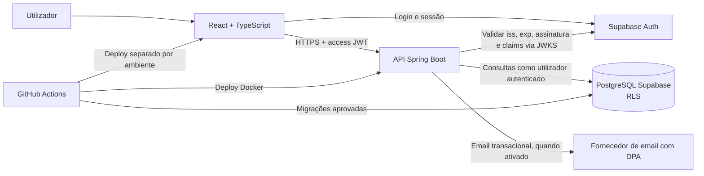
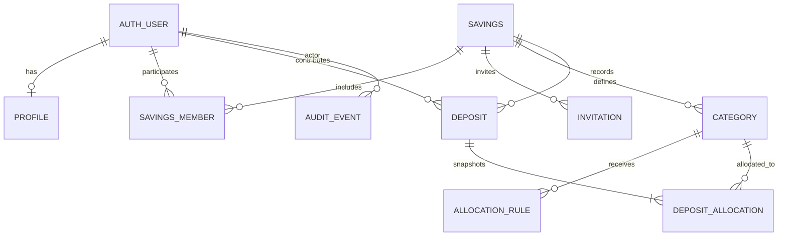
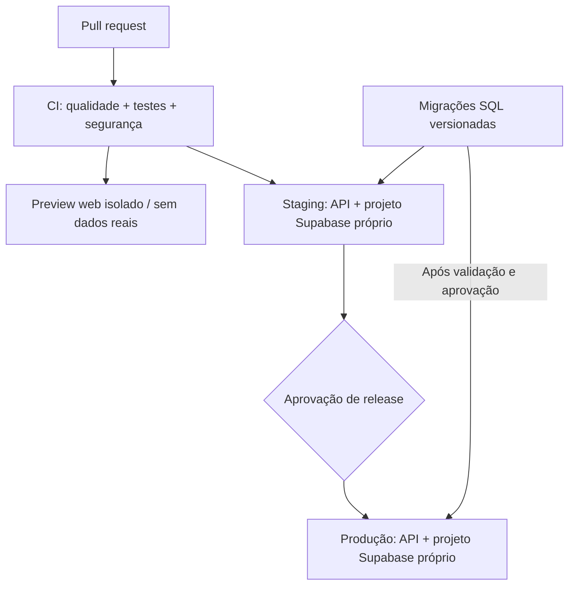

# Arquitetura e módulos

## Visão de contexto

### Caminho de uma chamada autenticada

1. O utilizador autentica-se pelo Supabase Auth. O frontend mantém a sessão com a biblioteca Supabase e não regista tokens em logs. A estratégia de armazenamento da sessão e a política CSP são requisitos de implementação e revisão.
2. O frontend envia `Authorization: Bearer <access-token>` à API Spring por HTTPS.
3. Spring Security valida assinatura, emissor, expiração e claims do token usando o JWKS do projeto Supabase. O `sub` validado é a identidade do ator. Nunca aceitar um `userId` do corpo como prova de identidade.
4. A API verifica autorização de domínio em cada pedido: propriedade, participação, papel e operação permitida. Por exemplo, só `OWNER` altera membros e partilha; `VIEWER` não altera depósitos.
5. Para acesso a dados, o Spring encaminha o JWT original do utilizador à Supabase Data API, acompanhado da publishable key do projeto. Assim Supabase valida a chamada e aplica `authenticated`, `auth.uid()` e RLS. O Spring não liga diretamente ao PostgreSQL com credencial elevada para pedidos normais. Não usar `service_role` como atalho para operações de utilizador.
6. Respostas e logs não incluem tokens, palavras-passe, convites secretos nem informação financeira que não seja necessária para diagnóstico.

JWT é identidade autenticada, não autorização suficiente: os papéis e a pertença a poupanças são confirmados no servidor/base de dados. Nunca usar `user_metadata` editável pelo utilizador para decidir permissões; não confiar em IDs fornecidos pelo browser. O JWT deve ser validado por biblioteca de confiança e chaves rotativas via JWKS. A publishable key pode estar no frontend/servidor; nunca enviar secret/service-role keys ao browser.

## Módulos de domínio

| Módulo | Entidades principais | Regras e limites |
|---|---|---|
| Conta | `auth.users`, `profiles` | Guardar apenas dados de perfil necessários. Eliminação e exportação têm fluxo explícito. |
| Poupança | `savings` | Privada por defeito; moeda e dono obrigatórios; objetivo opcional; estado ativo/arquivado. |
| Membresia | `savings_members`, `invitations` | Papéis por poupança; convite com token aleatório, hash armazenado, expiração e uso único; owner não pode ser removido sem transferência explícita. |
| Categorias | `categories`, `allocation_rules` | Percentagens não negativas e total 100% antes de ativar uma regra; validar também no servidor/transação. |
| Depósitos | `deposits`, `deposit_allocations` | Valor positivo e moeda explícita; alocações e percentagens são snapshots imutáveis da regra usada; alterações/correções geram evento compensatório em vez de apagar o histórico. |
| Dashboard | Consultas agregadas | Calcular apenas sobre dados autorizados. Não expor views que contornem RLS. Medir e otimizar depois de haver tráfego representativo. |
| Notificações | `notification_preferences`, outbox | Opt-in e preferências por finalidade; sem conteúdo financeiro em notificações de lock screen. MVP pode limitar-se a lembretes sem execução automática de depósitos. |
| Auditoria | `audit_events` | Eventos administrativos e de segurança com acesso restrito; não duplicar payloads financeiros nem guardar credenciais. Definir retenção e acesso. |

### Modelo relacional conceptual

Valores monetários usam `NUMERIC`/`DECIMAL`, nunca ponto flutuante binário. Guardar moeda como código ISO 4217 e data/hora em UTC; apresentar na zona horária do utilizador. Definir política de arredondamento e tratar o resto de cêntimos de forma determinística. O esquema físico será decidido em migrações e revisto antes de produção.

## Separação de ambientes

Cada ambiente tem projeto Supabase, chaves, URLs, contas de serviço e segredos independentes. Staging usa dados sintéticos. A seleção da região europeia e do plano Supabase é pré-requisito de produção: verificar disponibilidade, backups/PITR, localização de backups, subprocessadores, DPA e transferências no contrato efetivamente escolhido. Localização EU, por si só, não garante conformidade RGPD.

## Requisitos não funcionais

- HTTPS em todos os saltos externos; TLS para conexão à base de dados, com validação de certificado.
- Segredos em gestor de segredos do ambiente de deploy; nenhum segredo em Git, imagens, browser ou logs. Rotação documentada.
- RLS habilitada em cada tabela do schema exposto, grants mínimos, políticas por operação e testes positivos/negativos por papel.
- Paginação e limites de tamanho; validação server-side; limites de pedido e rate limiting em login, recuperação, convites e escrita.
- CORS por allowlist dos domínios de cada ambiente; CSP restritiva; prevenção de XSS e dependências com lockfiles.
- Backups, retenção, RPO/RTO e teste periódico de restauro definidos antes de produção. Backup não substitui exportação/eliminação aplicável.
- Métricas e logs com IDs de correlação pseudónimos. Não incluir access tokens, e-mails completos, payloads de depósitos ou secrets.
- Objetivos de latência são metas a medir em staging/produção; o requisito antigo `<200 ms` não é garantia sem carga, região e percentil definidos.

## Decisões ainda abertas

- Fornecedor e região exatos para frontend/API de produção; Lovable é prototipagem/preview até essa seleção.
- Versões de Java/Spring suportadas no início da implementação e política de atualização.
- Alojamento de email, analytics, logging e gestão de segredos; cada fornecedor precisa de avaliação de dados e contrato.
- Retenção por tipo de dado, critérios de arquivo e processo de eliminação em backups.
- Se e como habilitar MFA por defeito, exigência de MFA para funções privilegiadas e duração de sessão.
- AIPD/DPIA: documentar avaliação de necessidade e conclusão antes do lançamento.
