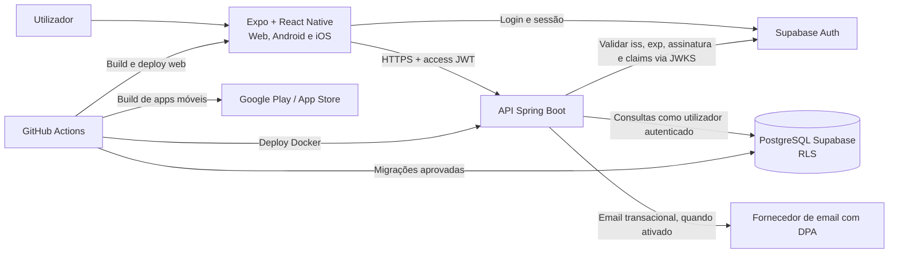
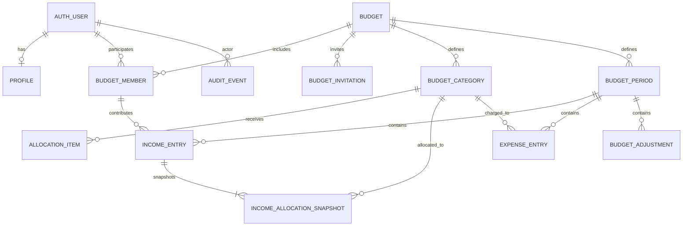
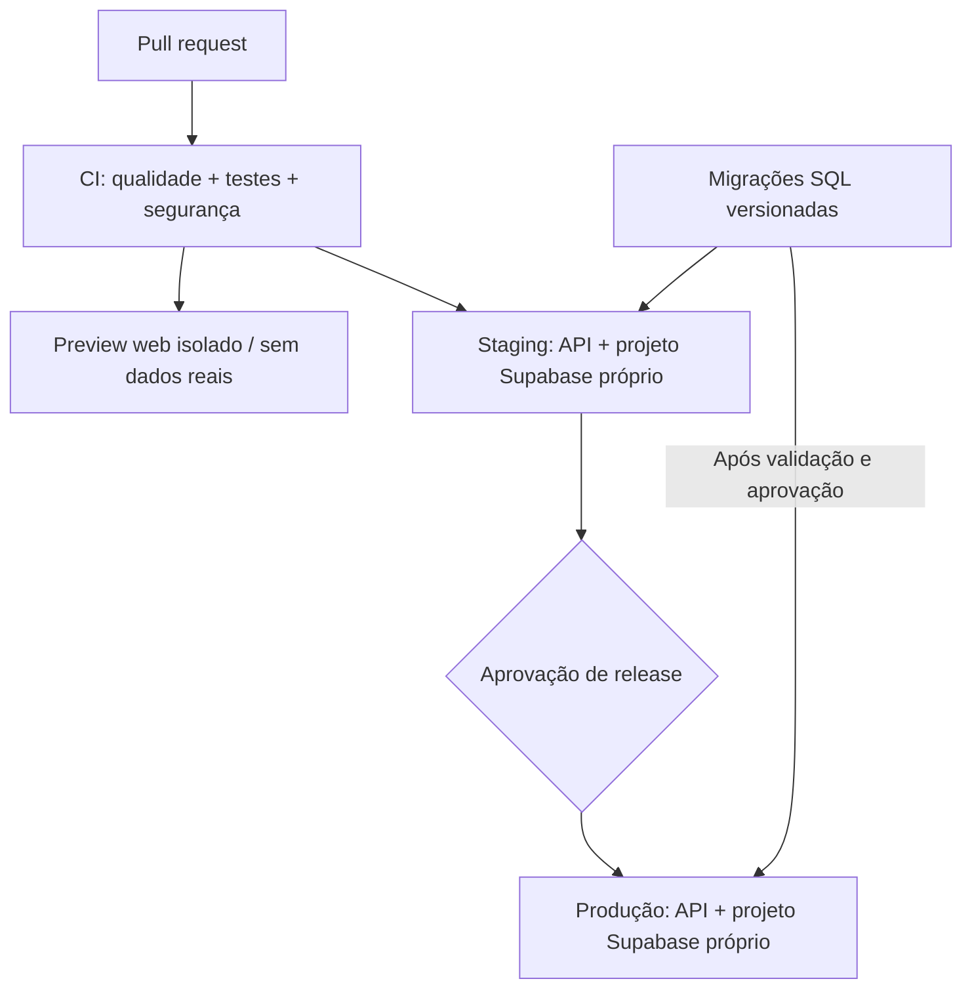

# Arquitetura e módulos

## Visão de contexto

### Caminho de uma chamada autenticada

1. O utilizador autentica-se pelo Supabase Auth. A aplicação Expo mantém a sessão com armazenamento adequado a cada plataforma e não regista tokens em logs. A estratégia de armazenamento da sessão e a política CSP são requisitos de implementação e revisão.
2. O frontend envia `Authorization: Bearer <access-token>` à API Spring por HTTPS.
3. Spring Security valida assinatura, emissor, expiração e claims do token usando o JWKS do projeto Supabase. O `sub` validado é a identidade do ator. Nunca aceitar um `userId` do corpo como prova de identidade.
4. A API verifica autorização de domínio em cada pedido: pertença ao orçamento, papel e operação permitida. Por exemplo, só `OWNER` altera membros e partilha; `VIEWER` não regista rendimentos, despesas ou ajustes.
5. Para acesso a dados, o Spring encaminha o JWT original do utilizador à Supabase Data API, acompanhado da publishable key do projeto. Assim Supabase valida a chamada e aplica `authenticated`, `auth.uid()` e RLS. O Spring não liga diretamente ao PostgreSQL com credencial elevada para pedidos normais. Não usar `service_role` como atalho para operações de utilizador.
6. Respostas e logs não incluem tokens, palavras-passe, convites secretos nem informação financeira que não seja necessária para diagnóstico.

JWT é identidade autenticada, não autorização suficiente: os papéis e a pertença a orçamentos são confirmados no servidor/base de dados. Nunca usar `user_metadata` editável pelo utilizador para decidir permissões; não confiar em IDs fornecidos pelo browser. O JWT deve ser validado por biblioteca de confiança e chaves rotativas via JWKS. A publishable key pode estar no frontend/servidor; nunca enviar secret/service-role keys ao browser.

## Módulos de domínio

| Módulo | Entidades principais | Regras e limites |
|---|---|---|
| Conta | `auth.users`, `profiles` | Guardar apenas dados de perfil necessários. Eliminar dados do orçamento pessoal; em orçamento partilhado, transferir primeiro a propriedade se necessário, retirar a membership ativa e remover a ligação direta ao utilizador, preservando autoria pseudonimizada, movimentos e auditoria para os restantes membros. |
| Orçamentos | `budgets`, `budget_members` | Orçamento pessoal ou partilhado, com moeda e owner obrigatórios. Todos os registos usam a moeda única do orçamento; rendimentos noutra moeda são rejeitados, sem conversão cambial no MVP. O partilhado usa um fundo comum; cada rendimento mantém a origem, mas o saldo e as categorias pertencem ao orçamento. |
| Períodos | `budget_periods` | Cada período tem datas inicial/final definidas pelo utilizador; rendimentos, despesas e ajustes pertencem a um período explícito. Os períodos são independentes: nenhum saldo positivo ou negativo transita para o seguinte. Constraint GiST impede sobreposição; triggers com lock transacional serializam alterações ao intervalo e movimentos, impedindo datas fora do período. Estatísticas anuais agregam movimentos pela data efetiva e podem incluir saldos negativos. |
| Convites | `budget_invitations` | Papéis por orçamento; convite com token aleatório, hash armazenado, expiração e uso único; owner só muda por transferência explícita. |
| Categorias e alocações | `budget_categories`, `budget_allocation_sets`, `budget_allocation_items` | Categorias e percentagens definidas pelo utilizador. A soma tem de ser exatamente 100%; a ativação só aceita categorias ativas e regista `effective_from` na data da ativação. Uma categoria usada na versão ativa só pode ser arquivada depois de ativar uma versão sem ela. Cada alteração cria uma nova versão. |
| Rendimentos | `income_entries`, `income_allocation_snapshots`, `income_schedules` | Registos virtuais com valor positivo e período explícito; `record_income` usa a alocação ativa no momento do registo, mesmo para uma data efetiva anterior, e grava snapshots determinísticos cuja soma reconcilia exatamente o rendimento. A versão usada é imutável no rendimento. Agendamentos só geram registos no SpendWise, sem movimentação real. |
| Despesas e ajustes | `expense_entries`, `budget_adjustments` | Despesa ligada a uma categoria e período; correções ligadas a uma despesa usam a mesma categoria, período e data efetiva originais, preservando também a data/hora em que o ajuste foi registado. O movimento original não é apagado. |
| Dashboard | Consultas agregadas | Saldo do período = alocações de rendimento + ajustes − despesas desse período; não há saldo de abertura vindo de períodos anteriores. Estatísticas anuais podem agregar os movimentos pela respetiva data efetiva dentro do ano, mesmo quando um período atravessa dois anos. Não expor views que contornem RLS. |
| Notificações | `budget_reminder_preferences` | Opt-in e preferências por finalidade; sem conteúdo de valores/categorias em notificações de lock screen. Outbox transacional fica para quando a entrega de notificações for implementada. |
| Auditoria | `budget_audit_events` | Eventos administrativos e de segurança com acesso restrito; não duplicar payloads financeiros nem guardar credenciais. Definir retenção e acesso. |

### Modelo relacional conceptual

Valores de planeamento usam `NUMERIC`/`DECIMAL`, nunca ponto flutuante binário. Guardar moeda como código ISO 4217 e data/hora em UTC; apresentar na zona horária do utilizador. Definir política de arredondamento e atribuição determinística do resto de cêntimos. O saldo é derivado dos snapshots de rendimento, despesas e ajustes; não se mantém um contador mutável como fonte de verdade.

## Separação de ambientes

Cada ambiente tem projeto Supabase, chaves, URLs, contas de serviço e segredos independentes. Staging usa dados sintéticos. A seleção da região europeia e do plano Supabase é pré-requisito de produção: verificar disponibilidade, backups/PITR, localização de backups, subprocessadores, DPA e transferências no contrato efetivamente escolhido. Localização EU, por si só, não garante conformidade RGPD.

## Requisitos não funcionais

- HTTPS em todos os saltos externos; TLS para conexão à base de dados, com validação de certificado.
- Segredos em gestor de segredos do ambiente de deploy; nenhum segredo em Git, imagens, browser ou logs. Rotação documentada.
- RLS habilitada em cada tabela do schema exposto, grants mínimos, políticas por operação e testes positivos/negativos por papel.
- Paginação e limites de tamanho; validação server-side; limites de pedido e rate limiting em login, recuperação, convites e escrita.
- CORS por allowlist dos domínios de cada ambiente; CSP restritiva; prevenção de XSS e dependências com lockfiles.
- Backups, retenção, RPO/RTO e teste periódico de restauro definidos antes de produção. Backup não substitui exportação/eliminação aplicável.
- Métricas e logs com IDs de correlação pseudónimos. Não incluir access tokens, e-mails completos, payloads de rendimentos/despesas ou secrets.
- Objetivos de latência são metas a medir em staging/produção; o requisito antigo `<200 ms` não é garantia sem carga, região e percentil definidos.

## Decisões ainda abertas

- Fornecedor e região exatos para frontend/API de produção; Lovable é prototipagem/preview até essa seleção.
- Versões de Java/Spring suportadas no início da implementação e política de atualização.
- Alojamento de email, analytics, logging e gestão de segredos; cada fornecedor precisa de avaliação de dados e contrato.
- Retenção por tipo de dado, critérios de arquivo e processo de eliminação em backups.
- Se e como habilitar MFA por defeito, exigência de MFA para funções privilegiadas e duração de sessão.
- AIPD/DPIA: documentar avaliação de necessidade e conclusão antes do lançamento.
