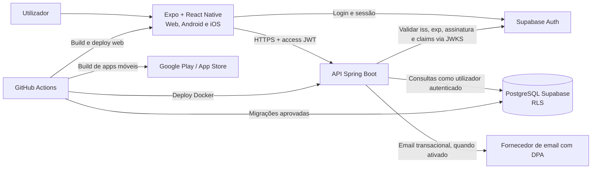
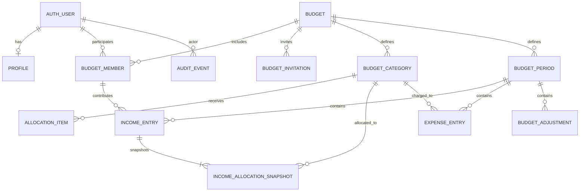
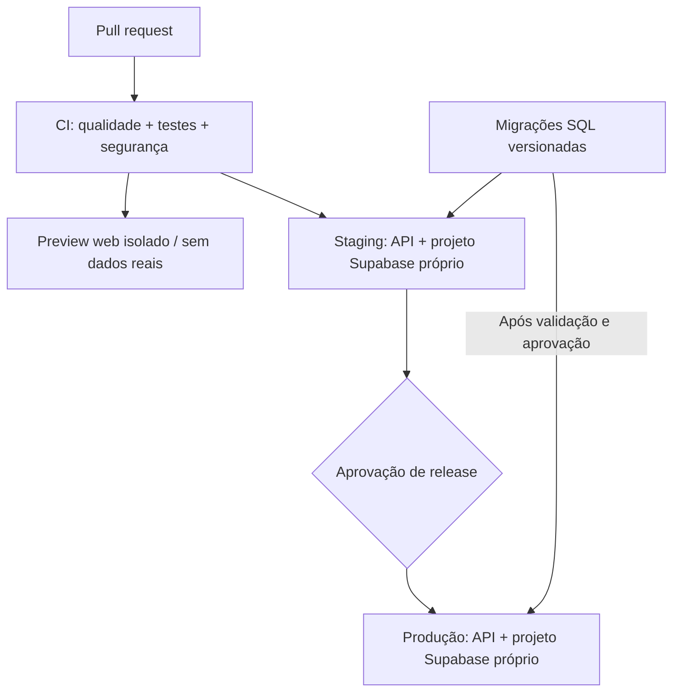

# Arquitetura e módulos

O backend usa Java 21, Spring Boot 4.2 e springdoc-openapi 3.2. A linha Spring Boot 4 traz Jackson 3; manter as anotações específicas de databind no namespace `tools.jackson` e confirmar que os contratos JSON continuam a serializar os nomes e formatos previstos.

## Visão de contexto

### Caminho de uma chamada autenticada

1. O utilizador regista-se, inicia sessão ou recupera o acesso pelo Supabase Auth com fluxo PKCE. No iOS/Android, a sessão persistida usa Expo SecureStore, fica acessível apenas com o dispositivo desbloqueado e é dividida em blocos abaixo do limite por valor do sistema. Na web, usa `sessionStorage`: sobrevive a recargas no mesmo separador e é removida quando este termina. JavaScript da página consegue ler a sessão web, por isso CSP, prevenção de XSS e controlo de dependências continuam necessários. Palavras-passe nunca são guardadas pela aplicação.
2. O frontend envia `Authorization: Bearer <access-token>` à API Spring por HTTPS.
3. Spring Security Resource Server valida a assinatura por JWKS e os claims `iss`, `exp` e `aud=authenticated`. Tokens com `aud=anon` são recusados. O `sub` validado é a identidade do ator. Nunca aceitar um `userId` do corpo como prova de identidade.
4. A API aplica validação de domínio e a Data API do Supabase aplica a autorização por linha e papel em cada pedido. Por exemplo, só `OWNER` altera configuração e membros; `OWNER`/`CONTRIBUTOR` registam rendimentos, despesas e ajustes; `VIEWER` só lê.
5. Para acesso a dados, o Spring encaminha o JWT original do utilizador à Supabase Data API, acompanhado da publishable key do projeto. Assim Supabase valida a chamada e aplica `authenticated`, `auth.uid()` e RLS. O Spring não liga diretamente ao PostgreSQL com credencial elevada para pedidos normais. Não usar `service_role` como atalho para operações de utilizador.
6. Respostas e logs não incluem tokens, palavras-passe, convites secretos nem informação financeira que não seja necessária para diagnóstico.

JWT é identidade autenticada, não autorização suficiente: os papéis e a pertença a orçamentos são confirmados no servidor/base de dados. Nunca usar `user_metadata` editável pelo utilizador para decidir permissões; não confiar em IDs fornecidos pelo browser. O JWT deve ser validado por biblioteca de confiança e chaves rotativas via JWKS. A publishable key pode estar no frontend/servidor; nunca enviar secret/service-role keys ao browser.

O redirect de confirmação e recuperação usa `spendwise://auth/callback` em aplicações móveis e o URL HTTPS do ambiente web. O callback troca o código PKCE por uma sessão e substitui imediatamente a rota, retirando o código de uso único do URL visível/histórico. Cada URL de redirect permitido deve ser configurado explicitamente no Supabase Auth; não usar curingas para produção.

### Matriz RLS e grants

| Dados/operação | Acesso |
|---|---|
| Perfil | Cada utilizador lê, cria e atualiza apenas o próprio perfil. |
| Orçamento e períodos | Membros ativos leem; OWNER altera nome/arquivo e datas dos períodos. Arquivar não bloqueia rendimentos, despesas ou ajustes dos membros ativos. |
| Membership | Membros ativos consultam o grupo; OWNER atualiza papel/remoção. Inserção e transferência de propriedade aguardam fluxos transacionais próprios. |
| Categorias e alocações | Membros ativos leem; OWNER cria/renomeia/arquiva categorias e gere rascunhos. RPCs `SECURITY INVOKER` derivam a membership de `auth.uid()` e criam/substituem itens de forma atómica. A ativação valida categorias ativas e soma de 100%, guarda `effective_from`; itens de versões ativas/retiradas são imutáveis. |
| Rendimentos, despesas e ajustes | Membros ativos leem o fundo comum; OWNER/CONTRIBUTOR registam, sem atualizar/apagar movimentos. Rendimento usa `record_income`. |
| Preferências de lembrete | Cada membro ativo lê e altera apenas a própria preferência. |
| Convites | OWNER cria e gere metadados; recebe um link de utilização única para copiar e partilhar. O segredo de 256 bits é descartável, apenas o SHA-256 é persistido e o token viaja no fragmento do URL. A RPC de aceitação valida email Auth confirmado, expiração e utilização única, e cria membership atomicamente. Aceitação: 5 tentativas/utilizador/15 min; criação: 10/orçamento/hora. Emails são removidos quando aceites/revogados e convites expirados são apagados 30 dias após a expiração. O hash do token não é legível pela Data API. |
| Auditoria | Membros ativos leem o histórico; clientes não escrevem eventos diretamente. |
| Membership removida e utilizador externo | Sem acesso aos dados do orçamento. Utilizadores anonimizados também não conseguem recuperar a associação anterior. |

As funções `private.current_budget_member_id` e `private.current_budget_member_role` usam `SECURITY DEFINER` apenas para evitar recursão da policy de `budget_members`; estão num schema não exposto, com `search_path` fixo, sem argumento `user_id` e com execução limitada a `authenticated`. As RPCs de domínio continuam `SECURITY INVOKER`, com uma exceção restrita para `public.create_budget`: a FK OWNER diferida exige criar orçamento e membership na mesma transação; a função usa `auth.uid()`, `search_path` fixo e não aceita identidade fornecida pelo cliente. Execução é concedida apenas a `authenticated`. A migration retira os grants Data API a `anon` e limita os grants de `authenticated` por tabela/coluna; outras operações com garantias transacionais específicas terão RPCs próprias.

## Módulos de domínio

| Módulo | Entidades principais | Regras e limites |
|---|---|---|
| Conta | `auth.users`, `profiles` | Guardar apenas dados de perfil necessários. Eliminar dados do orçamento pessoal; em orçamento partilhado, transferir primeiro a propriedade se necessário, retirar a membership ativa e remover a ligação direta ao utilizador, preservando autoria pseudonimizada, movimentos e auditoria para os restantes membros. |
| Orçamentos | `budgets`, `budget_members` | Orçamento pessoal ou partilhado, com moeda e owner obrigatórios. Todos os registos usam a moeda única do orçamento; rendimentos noutra moeda são rejeitados, sem conversão cambial no MVP. O partilhado usa um fundo comum; cada rendimento mantém a origem, mas o saldo e as categorias pertencem ao orçamento. |
| Períodos | `budget_periods` | Cada período tem datas inicial/final definidas pelo utilizador; rendimentos, despesas e ajustes pertencem a um período explícito. Os períodos são independentes: nenhum saldo positivo ou negativo transita para o seguinte. Constraint GiST impede sobreposição; triggers com lock transacional serializam alterações ao intervalo e movimentos, impedindo datas fora do período. Estatísticas anuais agregam movimentos pela data efetiva e podem incluir saldos negativos. Orçamentos arquivados continuam a aceitar movimentos dos membros ativos. |
| Convites | `budget_invitations` | Papéis por orçamento; convite com token aleatório, hash armazenado, expiração e uso único; owner só muda por transferência explícita. |
| Categorias e alocações | `budget_categories`, `budget_allocation_sets`, `budget_allocation_items` | Categorias e percentagens definidas pelo utilizador. Cada novo rascunho recebe uma versão sequencial e pode ser editado até à ativação. A ativação só aceita categorias ativas e percentagens que somam exatamente 100%; regista `effective_from` na data da ativação. Versões ativas/retiradas são imutáveis. Uma categoria usada na versão ativa só pode ser arquivada depois de ativar uma nova versão sem ela. |
| Rendimentos | `income_entries`, `income_allocation_snapshots`, `income_schedules` | Registos virtuais com valor positivo e período explícito; `record_income` usa a alocação ativa no momento do registo, mesmo para uma data efetiva anterior, e grava snapshots determinísticos cuja soma reconcilia exatamente o rendimento. A versão usada é imutável no rendimento. Um job diário `pg_cron` processa agendamentos através de uma função privada de acesso restrito; sem período compatível, a ocorrência permanece pendente na data original. Em recorrências mensais, o utilizador escolhe se usa o último dia ou salta o mês quando o dia âncora não existe. Se o criador perder permissões para registar, o agendamento é pausado automaticamente. Agendamentos só geram registos no SpendWise, sem movimentação real. |
| Despesas e ajustes | `expense_entries`, `budget_adjustments` | Despesa ligada a uma categoria e período; correções ligadas a uma despesa usam a mesma categoria, período e data efetiva originais, preservando também a data/hora em que o ajuste foi registado. O movimento original não é apagado. |
| Dashboard | Consultas agregadas | Saldo do período = alocações de rendimento + ajustes − despesas desse período; não há saldo de abertura vindo de períodos anteriores. Estatísticas anuais podem agregar os movimentos pela respetiva data efetiva dentro do ano, mesmo quando um período atravessa dois anos. Não expor views que contornem RLS. |
| Notificações | `budget_reminder_preferences` | Opt-in e preferências por finalidade; sem conteúdo de valores/categorias em notificações de lock screen. Outbox transacional fica para quando a entrega de notificações for implementada. |
| Auditoria | `budget_audit_events` | Eventos administrativos e de segurança com acesso restrito; não duplicar payloads financeiros nem guardar credenciais. Definir retenção e acesso. |

### Modelo relacional conceptual

Valores de planeamento usam `NUMERIC`/`DECIMAL`, nunca ponto flutuante binário. Guardar moeda como código ISO 4217 e data/hora em UTC; apresentar na zona horária do utilizador. Definir política de arredondamento e atribuição determinística do resto de cêntimos. O saldo é derivado dos snapshots de rendimento, despesas e ajustes; não se mantém um contador mutável como fonte de verdade.

## Separação de ambientes

Cada ambiente tem projeto Supabase, chaves, URLs, contas de serviço e segredos independentes. Staging usa dados sintéticos. A região escolhida é Paris (`eu-west-3`); Supabase Free é aceite para desenvolvimento/staging e piloto inicial de baixa afluência. O plano Free pode pausar projetos inativos e não inclui backups geridos; não há compromisso de SLA e o piloto deve ser promovido/reavaliado antes de aumentar a utilização. A escolha da região não garante conformidade RGPD.

### Cópias de segurança e recuperação

- Objetivos aprovados: RPO até 24 horas, RTO até 8 horas e retenção de 7 dias.
- Destino planeado: Cloudflare R2 com jurisdição EU, usando exclusivamente a quota gratuita (10 GB-mês na data desta decisão). Cifrar o artefacto no cliente antes do upload; guardar chaves de cifragem separadas do bucket e com acesso operacional restrito.
- Parar o envio e alertar antes de ultrapassar a quota gratuita; não ativar faturação/overage. A disponibilidade da cópia não pode depender apenas de um cron de GitHub Actions, pois os horários podem atrasar ou falhar: monitorizar frescura e alertar quando a última cópia válida exceder 24 horas.
- Um dump PostgreSQL padrão da CLI Supabase exclui schemas geridos como `auth`; portanto, backup da aplicação sozinho não cumpre recuperação. O procedimento deve capturar e validar separadamente `auth.users` e tabelas relacionadas, definir restauro seguro num projeto limpo, e preservar/configurar separadamente settings Auth, chaves e segredos. Tokens ativos podem deixar de ser válidos após migração.
- Cópias incluem dados pessoais e valores virtuais: controlar acesso, cifrar antes da saída, testar a eliminação por expiração após 7 dias e documentar que pedidos de apagamento podem permanecer nas cópias até essa expiração.
- Realizar exercício de restauro trimestral. RPO/RTO são alvos aprovados, não garantias, até se demonstrar um restauro completo de dados e Auth dentro dos tempos definidos.

Lovable fica limitado a prototipagem/preview, sem Lovable Cloud/backend. A produção web via hosting Lovable não está aprovada; frontend e backend de produção continuam sem fornecedor selecionado.

## Requisitos não funcionais

- HTTPS em todos os saltos externos; TLS para conexão à base de dados, com validação de certificado.
- Segredos em gestor de segredos do ambiente de deploy; nenhum segredo em Git, imagens, browser ou logs. Rotação documentada.
- RLS habilitada em cada tabela do schema exposto, grants mínimos, políticas por operação e testes positivos/negativos por papel.
- Paginação e limites de tamanho; validação server-side; limites de pedido e rate limiting em login, recuperação, convites e escrita.
- CORS por allowlist dos domínios de cada ambiente; CSP restritiva; prevenção de XSS e dependências com lockfiles.
- Backups: decisões para piloto definidas acima; automação, cópia completa de Auth, alertas de frescura e teste periódico de restauro ainda por implementar/validar. Backup não substitui exportação/eliminação aplicável.
- Métricas e logs com IDs de correlação pseudónimos. Não incluir access tokens, e-mails completos, payloads de rendimentos/despesas ou secrets.
- Objetivos de latência são metas a medir em staging/produção; o requisito antigo `<200 ms` não é garantia sem carga, região e percentil definidos.

## Decisões ainda abertas

- Fornecedor de hosting para frontend/API de produção; Lovable é prototipagem/preview, sem backend.
- Versões de Java/Spring suportadas no início da implementação e política de atualização.
- Alojamento de email, analytics, logging e gestão de segredos; cada fornecedor precisa de avaliação de dados e contrato.
- Contratos/DPA e subprocessadores dos fornecedores selecionados; processo operacional de eliminação em backups após a retenção de 7 dias.
- Se e como habilitar MFA por defeito, exigência de MFA para funções privilegiadas e duração de sessão.
- AIPD/DPIA: documentar avaliação de necessidade e conclusão antes do lançamento.
