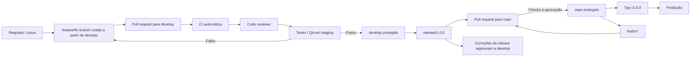

# Fluxo de desenvolvimento e CI/CD

## Fluxo de trabalho

### Branches e revisão

- **Gitflow:** `main` representa produção e `develop` integra a próxima release. Ambas são protegidas; sem pushes diretos.
- Criar branches curtas `feature/...`, `fix/...` ou `docs/...` a partir de `develop`; abrir PR de volta para `develop`. Branches de agentes podem usar `codex/...`, mantendo o mesmo destino e gates.
- Criar `release/X.Y.Z` a partir de `develop` quando o escopo estiver congelado. Aí entram apenas correções de estabilização. Depois da aprovação, abrir PR para `main`, criar a tag `vX.Y.Z` no merge e devolver todas as correções da release a `develop`.
- Criar `hotfix/X.Y.Z` a partir de `main` para uma correção urgente em produção; após revisão, integrar em `main` e `develop` e em qualquer release ainda ativa.
- PR contém objetivo, risco, como validar, migrações, impacto em dados pessoais e passos de rollback. Não incluir dados reais em screenshots, fixtures ou issue.
- Code reviewer revê autorização, RLS, migrações, exposição de segredos, logging, privacidade e erros; reviewer automático é apoio, nunca aprovação final para segurança.
- Tester independente do autor confirma critérios de aceitação em staging e regista resultado. Bugs bloqueadores regressam ao PR.
- Exigir pelo menos uma aprovação humana. Alterações a migrações, auth, RLS, segredos ou produção precisam de aprovação de pessoa responsável por segurança/dados.

## Pipeline de CI

### Em cada pull request

1. Formatação/lint, verificação de tipos e testes unitários/componentes do frontend.
2. Testes E2E Playwright em Chromium desktop e viewport Pixel 7 emulada; axe verifica WCAG 2.0/2.1 A/AA nos ecrãs cobertos. A suíte usa dados sintéticos e intercepta Auth/API, sem aceder a projetos Supabase reais.
3. Build web e auditoria de dependências de produção.
4. Compilação e testes Maven, incluindo integração da API com Supabase Auth/RLS local e credenciais efémeras.
5. Aplicar migrações desde uma base local vazia e executar pgTAP para validar RLS e grants.
6. Construir o container e verificar dependências, segredos, configuração e vulnerabilidades Trivy.

Os comandos e versões concretos são fixados nos lockfiles pnpm, Maven Wrapper e workflow. GitHub Actions ficam pinadas por SHA, com `permissions` mínimos e concorrência por workflow/branch. Mudanças no CLI Supabase devem ser verificadas contra o changelog e a versão/comandos usados na CI não devem flutuar.

O workflow `.github/workflows/ci.yml` corre nos pull requests e em `develop`/`main`. O job frontend inicia Expo para os testes E2E locais; os testes usam mocks e nunca usam dados ou segredos de produção. O job de dados inicia Supabase local, aplica migrations, executa pgTAP e o teste de integração Spring/Auth/RLS com credenciais locais efémeras. A pipeline também executa build web, testes Maven, auditorias, scans de segurança e build Docker. A emulação Pixel verifica o layout web responsivo e não substitui testes nativos em Android/iOS ou testes em staging. A promoção/deploy para staging ou produção permanece noutras tarefas.

## Staging e produção

| Passo          | Staging                                                                                        | Produção                                                                                                                                                           |
| -------------- | ---------------------------------------------------------------------------------------------- | ------------------------------------------------------------------------------------------------------------------------------------------------------------------ |
| Infraestrutura | Ambiente persistente isolado e preview efémero sem dados reais.                                | Ambiente separado e restrito.                                                                                                                                      |
| Supabase       | Projeto, Auth, base de dados, chaves e URLs próprios em Paris (`eu-west-3`); dados sintéticos. | Projeto, credenciais, Auth e URLs próprios. Plano/contratos reavaliados antes do lançamento/escala.                                                                |
| Migrações      | Aplicar automaticamente após os checks, com cópia descartável ou branch de validação.          | Job dedicado com aprovação protegida, backup recente e migração compatível/expand-contract.                                                                        |
| API            | Imagem Docker etiquetada por commit; smoke tests.                                              | Mesma imagem validada, promovida sem rebuild; health checks e rollback.                                                                                            |
| Frontend       | Preview por PR e URL de staging.                                                               | Deploy do mesmo commit aprovado. Lovable pode apoiar previews; não é autoridade de produção enquanto região, contratos e processo de rollback não forem avaliados. |
| Segredos       | Environment secrets de staging apenas.                                                         | GitHub Environment de produção, menor privilégio e acesso restrito; nunca nos logs.                                                                                |

Não copiar dados de produção para ambientes inferiores. Não executar `ddl-auto=update` em produção; Flyway (ou ferramenta de migrações escolhida) é a fonte reproduzível do esquema. Migrações de remoção/alteração incompatível usam sequência expand/contract e plano de recuperação. Rollback de aplicação não implica rollback cego de dados.

## Release e incidentes de deploy

1. Merge em `main` cria artefacto imutável, identificado por commit.
2. Artefacto e migrações são validados em staging.
3. Testes de aceitação, segurança e privacidade são registados.
4. Pessoa autorizada aprova job `production`; secrets só ficam disponíveis nesse environment.
5. Aplicar migração compatível e depois publicar frontend/API; executar smoke test e verificar métricas/erros.
6. Se falhar, interromper promoção, reverter artefacto compatível e executar runbook. Avaliar migração e dados sem apagar evidência.

### Piloto e recuperação

O piloto inicial pode usar Supabase Free em Paris para baixa afluência. A equipa aceita que o plano Free pode pausar projetos inativos e não oferece backups geridos; não prometer SLA. Lovable serve para protótipos/previews, sem backend/Lovable Cloud; o seu hosting não é ainda o destino aprovado para produção.

Objetivos aprovados: RPO ≤24h, RTO ≤8h e retenção de 7 dias, com cópias cifradas no cliente para Cloudflare R2 sob jurisdição EU, limitadas à quota gratuita. O job deve falhar/alertar antes de qualquer overage. A cópia deve incluir a base de dados e Auth; `supabase db dump` padrão exclui o schema `auth`, pelo que a implementação tem de cobrir essa lacuna. Alertar se a cópia válida mais recente ultrapassar 24h e executar exercício trimestral. GitHub Actions schedule é best effort e não constitui por si só garantia de RPO.

Antes de produção/aceitação de dados reais, concluir revisão contratual/DPA e subprocessadores, demonstrar restauro completo de base de dados + Auth dentro do RTO, verificar retenção e eliminação, e rever se o plano Free continua adequado. Até ao exercício, RPO/RTO são metas, não garantias.

Cada fornecedor de hospedagem/segredos/monitorização será escolhido antes da produção com revisão do DPA, subprocessadores, residência, backups, logging e resposta a incidentes.

## Critérios de aceite por funcionalidade

- Requisito funcional e critérios de aceitação verificáveis.
- Modelo de dados e papéis de acesso descritos.
- Testes de autorização/RLS incluem um utilizador sem acesso e um utilizador revogado.
- Impacto em dados pessoais, finalidade, retenção e exportação/eliminação considerado.
- Sem segredos ou dados reais no código, fixtures, screenshots e logs.
- Reviewer aprova; QA regista testes em staging; documentação atualizada.
