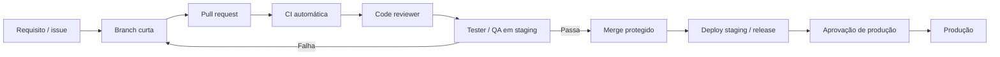

# Fluxo de desenvolvimento e CI/CD

## Fluxo de trabalho

### Branches e revisão

- `main` protegida; alterações via PR e checks obrigatórios. Branches pequenas, por exemplo `feature/...`, `fix/...`, `docs/...`.
- PR contém objetivo, risco, como validar, migrações, impacto em dados pessoais e passos de rollback. Não incluir dados reais em screenshots, fixtures ou issue.
- Code reviewer revê autorização, RLS, migrações, exposição de segredos, logging, privacidade e erros; reviewer automático é apoio, nunca aprovação final para segurança.
- Tester independente do autor confirma critérios de aceitação em staging e regista resultado. Bugs bloqueadores regressam ao PR.
- Exigir pelo menos uma aprovação humana. Alterações a migrações, auth, RLS, segredos ou produção precisam de aprovação de pessoa responsável por segurança/dados.

## Pipeline de CI

### Em cada pull request

1. Formatação/lint e verificação de tipos do frontend.
2. Build React e testes unitários.
3. Java compile, Checkstyle/format, testes unitários Spring e análise de dependências.
4. Testes de integração da API com PostgreSQL descartável; autenticação positiva/negativa e autorização por papel.
5. Aplicar migrações desde base vazia e testar as migrações contra staging antes da promoção. Testes SQL de RLS confirmam casos permitidos e negados para cada papel e para `anon`.
6. Verificar OpenAPI, dependências vulneráveis, secret scanning e configuração de container.
7. Criar preview sem dados reais. Não disponibilizar segredos de produção a workflows de PR, forks ou código não confiável.

Os comandos e versões concretos são fixados em lockfiles/Gradle wrapper e workflow. Pin de GitHub Actions por SHA, `permissions` mínimos, environments protegidos e concorrência de deploy por ambiente. Mudanças no CLI Supabase devem ser verificadas contra changelog; a versão 3 alterou o comportamento do CLI para local por defeito, pelo que a versão e os comandos de CI não devem flutuar.

## Staging e produção

| Passo | Staging | Produção |
|---|---|---|
| Infraestrutura | Ambiente persistente isolado e preview efémero sem dados reais. | Ambiente separado e restrito. |
| Supabase | Projeto, Auth, base de dados, chaves e URLs próprios; dados sintéticos. | Projeto, credenciais, Auth e URLs próprios; região/contrato aprovados. |
| Migrações | Aplicar automaticamente após os checks, com cópia descartável ou branch de validação. | Job dedicado com aprovação protegida, backup recente e migração compatível/expand-contract. |
| API | Imagem Docker etiquetada por commit; smoke tests. | Mesma imagem validada, promovida sem rebuild; health checks e rollback. |
| Frontend | Preview por PR e URL de staging. | Deploy do mesmo commit aprovado. Lovable pode apoiar previews; não é autoridade de produção enquanto região, contratos e processo de rollback não forem avaliados. |
| Segredos | Environment secrets de staging apenas. | GitHub Environment de produção, menor privilégio e acesso restrito; nunca nos logs. |

Não copiar dados de produção para ambientes inferiores. Não executar `ddl-auto=update` em produção; Flyway (ou ferramenta de migrações escolhida) é a fonte reproduzível do esquema. Migrações de remoção/alteração incompatível usam sequência expand/contract e plano de recuperação. Rollback de aplicação não implica rollback cego de dados.

## Release e incidentes de deploy

1. Merge em `main` cria artefacto imutável, identificado por commit.
2. Artefacto e migrações são validados em staging.
3. Testes de aceitação, segurança e privacidade são registados.
4. Pessoa autorizada aprova job `production`; secrets só ficam disponíveis nesse environment.
5. Aplicar migração compatível e depois publicar frontend/API; executar smoke test e verificar métricas/erros.
6. Se falhar, interromper promoção, reverter artefacto compatível e executar runbook. Avaliar migração e dados sem apagar evidência.

Cada fornecedor de hospedagem/segredos/monitorização será escolhido antes da produção com revisão do DPA, subprocessadores, residência, backups, logging e resposta a incidentes.

## Critérios de aceite por funcionalidade

- Requisito funcional e critérios de aceitação verificáveis.
- Modelo de dados e papéis de acesso descritos.
- Testes de autorização/RLS incluem um utilizador sem acesso e um utilizador revogado.
- Impacto em dados pessoais, finalidade, retenção e exportação/eliminação considerado.
- Sem segredos ou dados reais no código, fixtures, screenshots e logs.
- Reviewer aprova; QA regista testes em staging; documentação atualizada.
